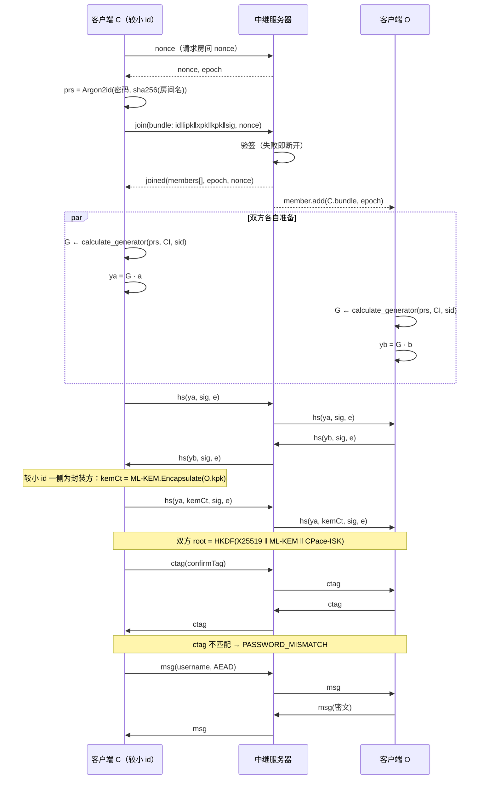

# ZQ-Chat

端到端加密聊天。服务器仅作为盲中继，不持有任何解密能力。

## 部署

### Cloudflare Workers 一键部署

[](https://deploy.workers.cloudflare.com/?url=https://github.com/asgitnow/zq-chat)

> 该方式基于主仓库创建独立项目，后续主仓库更新不会自动同步。

### fork 后自动同步部署

1. fork 本项目到自己的 GitHub 账号。
2. 在 Cloudflare Workers 控制台选择「从 GitHub 导入」，选择 fork 后的仓库部署。

> 仓库内置同步 workflow，fork 后主仓库更新会自动同步并触发重新部署。

## 相比原版的安全性改进

本仓库是原版 ZQ-Chat 的安全性优化版，替换了部分密码学实现，前端只做适配性调整，体验接近。

原版把房间密码当作 `ECDH_共享密钥 XOR SHA256(密码)`，用 RSA-2048 做服务器身份验证、AES-256-CBC 加密传输层信封。

存在三个结构性问题：

- 密码经 SHA256 直接进入密钥，**可完全离线爆破**——拿到一点公开材料就能字典攻击；
- AES-256-CBC **没有 MAC**，密文可被篡改，且存在 padding oracle 面；
- 服务器持有 RSA 私钥并参与身份验证，与"零知识"的说法不符。

本版针对这三点做了替换：

| | 原版 | 本版 |
|---|---|---|
| 密码参与方式 | `ECDH_ss XOR SHA256(密码)` | CPace PAKE（draft-irtf-cfrg-cpace，套件 `CPACE-RISTR255-SHA512`），密码只参与生成元 `G` |
| 离线爆破 | 可行（SHA256 无记忆开销） | 不可行：验证一个猜测必须完成一次交互握手 |
| 密码错误 | 解密出乱码，无法归因 | 双向 `confirmTag`，明确 `PASSWORD_MISMATCH` |
| 握手密钥 | Curve25519 | X25519 + ML-KEM-768 混合（PQC） |
| 传输层信封 | AES-256-CBC，**无 MAC** | 明文 JSON——服务器零密钥，无需加密 |
| 消息 AEAD | ChaCha20（无认证） | XChaCha20-Poly1305，AAD 绑定收发方与 epoch |
| 服务器角色 | 持有 RSA 私钥，自称身份 | 无任何密钥，按房间分片的盲中继 |
| 加入房间 | 不校验 bundle | bundle 由身份密钥签名，验签失败即拒 |
| 安全码 | 无 | 会话指纹，Web 界面与 CLI 均可展示，供检测 MITM |

加入了 headless Cli 以便于集成入各类现实部署。

## 架构

- **前端**：ES6+ 模块化 JavaScript，无框架依赖
- **后端**：Cloudflare Workers + Durable Objects
- **通信**：WebSocket
- **构建**：Vite

## 零知识设计

### 核心原则

- **服务器盲转**：服务器不持有任何解密能力，仅路由密文
- **无持久化存储**：所有数据仅存在于内存
- **端到端加密**：加解密全部在客户端完成
- **前向安全**：无历史消息，密钥泄露不影响已过内容
- **匿名**：无需注册，全临时身份

### 隐私机制

- **成员列表透明**：任何人加入或离开实时通知全体成员
- **无历史消息**：新加入者无法看到任何此前记录
- **私聊**：头像点击发起端到端加密私聊，房间内其他成员不可见

### 房间密码机制

房间密码通过 **CPace**（[draft-irtf-cfrg-cpace](https://datatracker.ietf.org/doc/draft-irtf-cfrg-cpace/)，
密码套件 `CPACE-RISTR255-SHA512`）参与密钥协商，不直接拼入密钥：

```
prs  = Argon2id(房间密码, salt = sha256(房间名))              // 密码拉伸 t=2, m=19MiB, p=1
G    = element_derivation( SHA512( lv_cat(DSI, prs, zero_bytes(len_zpad), CI, sid) ) )
ya   = G · a                                                   // 双方各自随机标量
ISK  = SHA512( lv_cat("CPaceRistretto255_ISK", sid, Y_peer·a) ‖ transcript_oc(ya, y_peer) )
root = HKDF-SHA256(X25519_共享密钥 ‖ ML-KEM-768_共享密钥 ‖ ISK,
                   info = "zqchat/v2/root{lo}{hi}")
```

CPace 部分逐函数对应草案原文（`prepend_len` / `lv_cat` / `o_cat` / `generator_string` /
`calculate_generator` / `sample_scalar` / `scalar_mult_vfy` / `transcript_oc`），未作简化，
并以草案附录 B.3 的官方测试向量逐字节验证（`node tests/cpace-vectors.mjs`）。

- **不可离线爆破**：攻击者即便持有全部公开材料（`ya`、`sid`、`CI`）并猜对密码，也无法离线复现 `ISK`，必须完成一次交互才能验证一个猜测。
- **密码错误可辨**：握手末尾交换双向 `confirmTag`（16B），不匹配即 `PASSWORD_MISMATCH` 并丢弃该会话，双方读不到任何明文。
- **服务器无盲区入口**：服务器只转发 bundle 与密文。
- **原文不驻留**：首次 Argon2id 拉伸后即抹除密码明文，仅缓存 `prs` 供重连复用。

> 密码不参与准入：知道房间名即可加入（看到成员列表、发起在线猜测）。房间名是标识而非凭证。不同密码的人会进同一中继房间，互相解不开并互踢。
>
> 无密码房间的 MITM 防护依赖安全码比对，显著优于无可验证渠道的安全性。成员面板右上角的「安全码」按钮会列出每个 peer 的指纹，验证后可信；headless CLI 同样会打印。

### 安全层次

服务器与客户端之间是明文 JSON 信封——服务器不持有密钥，也就无从需要被认证。安全性全部落在端到端侧：

| 层 | 机制 |
|---|---|
| 身份 | Ed25519 长期密钥对，`id = sha256(公钥)[:12]`；bundle 由身份密钥签名，中继验签失败即拒（`BAD_BUNDLE`） |
| 握手 | X25519 + ML-KEM-768 混合（PQC），`(ya, kemCt)` 单独签名防重放 |
| 密钥协商 | CPace PAKE（对齐草案官方实现），密码错误显式可辨 |
| 消息加密 | XChaCha20-Poly1305，AAD 绑定 `from/to/room/n/epoch` 与文件分片元数据 |
| 密钥轮换 | epoch 驱动、零往返；成员变化时服务器广播 +1（5s 合并窗口） |
| 重放防护 | 单向消息密钥链 + 每轮 seq 去重窗口 |
| MITM 检测 | 成员面板展示每条会话的指纹（安全码），双方可带外比对 |

## 握手流程



## 技术实现

密码学基于 `@noble/*`：

- `@noble/post-quantum`：ML-KEM-768
- `@noble/curves`：X25519、Ed25519、Ristretto255
- `@noble/ciphers`：XChaCha20-Poly1305
- `@noble/hashes`：Argon2id、HKDF-SHA256、SHA-256/512

其他：`dompurify`（消息渲染净化）、`fflate`（文件压缩）、`geektls`（可选 TLS）。

### 代码结构

| 路径 | 职责 |
|---|---|
| `client/js/zqcrypto.mjs` | Identity / Session / Argon2id / 填充 / 令牌桶 |
| `client/js/zqcpace.mjs` | CPace PAKE，对齐 draft-irtf-cfrg-cpace |
| `client/js/NodeCrypt.js` | 握手状态机、消息链、重连退避（浏览器 + Node） |
| `client/js/argon.worker.js` | Argon2id 置于 Web Worker，避免阻塞 UI |
| `worker/` | Worker 盲中继，Durable Object 按房间分片 |
| `headless/zqchat.mjs` | CLI 通道 |
| `echbridge/` | Go TLS ECH 桥（本地直接接入的有效通道，部署无关） |
| `tests/` | 密码学单元 90 项（含 CPace 官方向量 15 项）+ 中继 E2E 34 项 |

## 测试

```bash
npm install
node tests/crypto.test.mjs      # 密码学单元测试（含 CPace 草案官方测试向量）
node tests/e2e-relay.test.mjs   # 真实 worker 源码 + 真实客户端的端到端测试
node tests/cpace-vectors.mjs    # 单独跑 CPace 向量对齐校验
```

抓包可见 WebSocket 上只有 bundle 与密文；E2E 测试对服务器经手的每一帧断言不含明文。

## 文档

| 文档 | 内容 |
|---|---|
| [doc/spec-v2.md](doc/spec-v2.md) | 实现规格：身份层、CPace、密钥派生、握手状态机、epoch 轮换、错误码 |
| [doc/api.md](doc/api.md) | 程序调用：`NodeCrypt` / `Identity` / `Session` 接口、消息类型、headless CLI |
| [doc/wire-v2.md](doc/wire-v2.md) | 线上帧协议与中继侧约束 |

## 使用注意

- 房间密码建议用 4 个以上随机词组成的口令，允许空格与符号，长度上限 128
- 密码泄露后该房间后续内容可被解密
- 核对安全码是检测 MITM 的唯一手段，对于无密码房间；设置密码则具有默认安全性
- 分享链接中的房间参数是混淆编码而非加密，密码以可还原形式存在。分享协商流程的结构性问题，可多样化混淆方式/可信渠道传输以缓解

## 协议

ISC